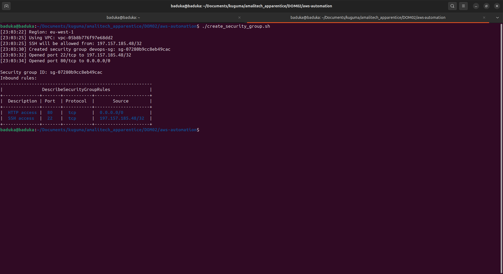
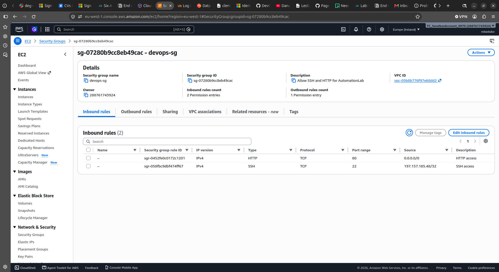
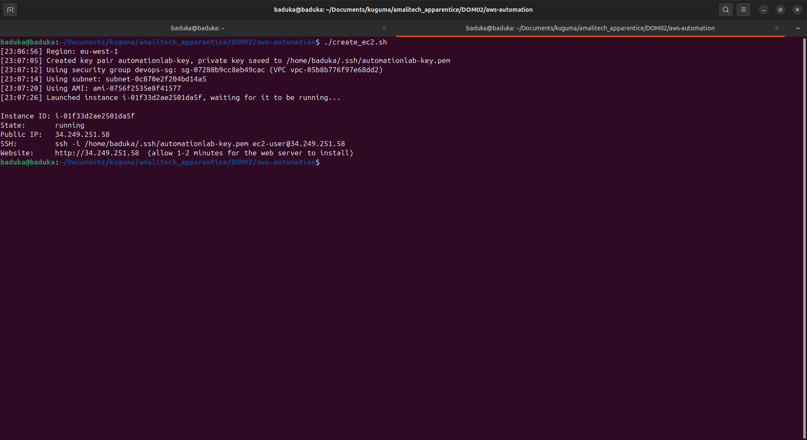
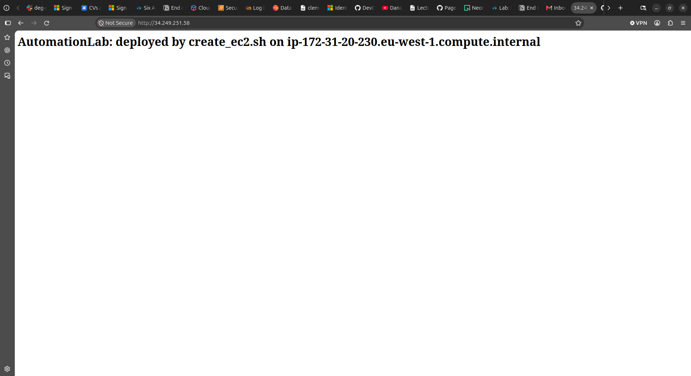
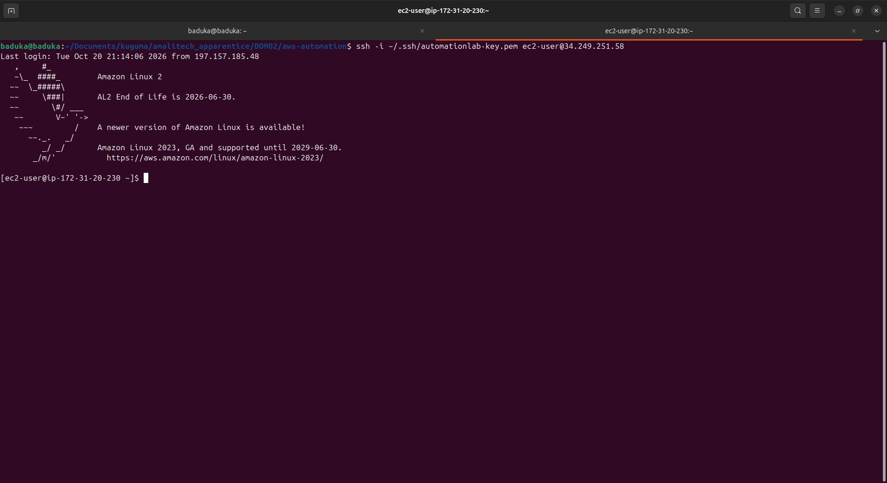
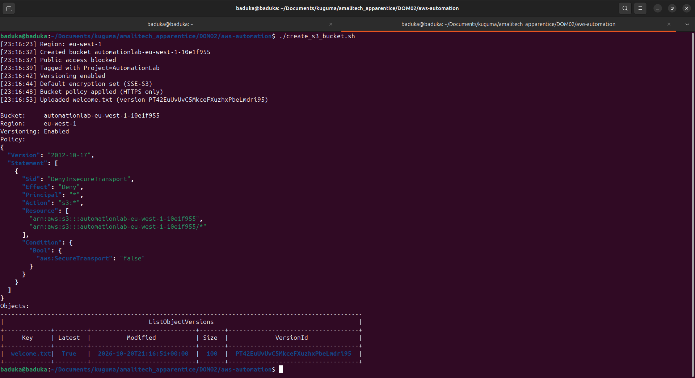
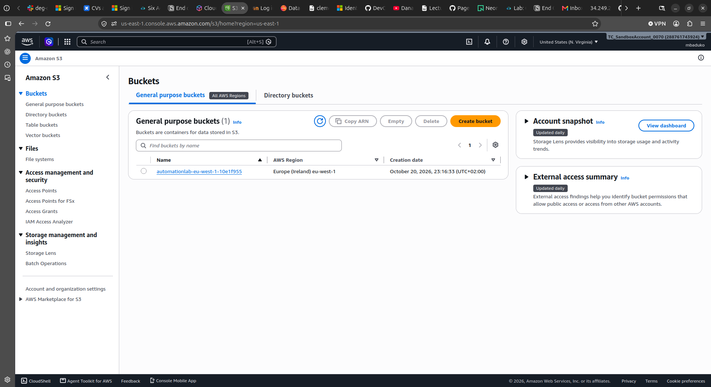
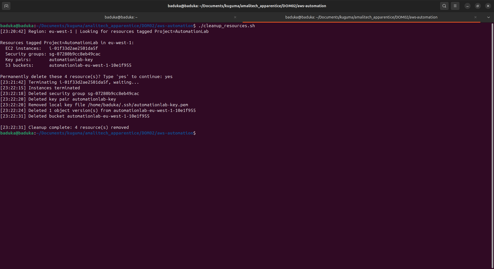
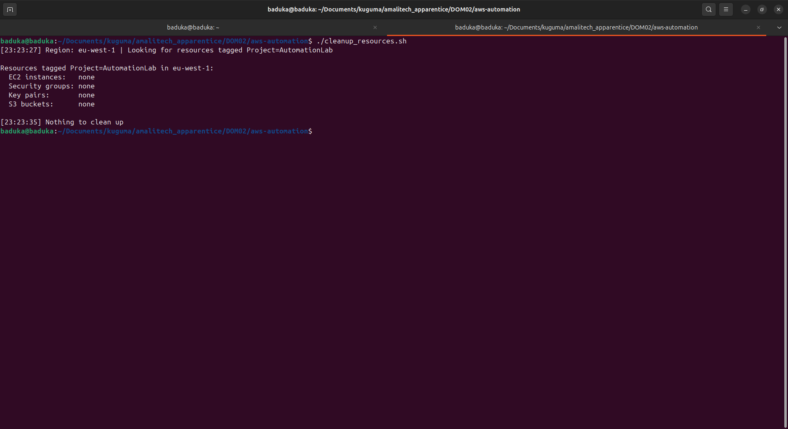

# AWS Resource Automation with Bash

Bash scripts that use the AWS CLI to create, verify and clean up an EC2 instance, a Security Group and an S3 bucket.

Every resource is tagged `Project=AutomationLab`, and the cleanup script finds what to delete by that tag. All scripts stop at the first error and are safe to re-run: existing resources are reused, not duplicated.

## Scripts
v
| Script | Purpose |
|---|---|
| `create_security_group.sh` | Creates `devops-sg` in the default VPC. Opens port 22 (SSH) to **my IP only** and port 80 (HTTP) to everyone. Prints the group ID and its rules. |
| `create_ec2.sh` | Creates an ED25519 key pair, saved to `~/.ssh/automationlab-key.pem` with permissions `400`. Launches a free-tier Amazon Linux 2 instance with an encrypted disk, IMDSv2 required, and Apache installed on first boot. Prints the instance ID and public IP. |
| `create_s3_bucket.sh` | Creates a uniquely named bucket. Blocks public access, enables versioning and encryption, and applies an HTTPS-only bucket policy. Uploads `welcome.txt`. |
| `cleanup_resources.sh` | Finds everything tagged `Project=AutomationLab` and deletes it in dependency order: instances, then security groups, key pairs, then buckets (all object versions first). Supports `--dry-run`, and asks for confirmation unless `--yes` is given. |

## Prerequisites

- An AWS account with an IAM user (not root) that can manage EC2, S3 and SSM parameters
- AWS CLI v2, `jq` and `curl`
- Credentials and a region configured:

```bash
aws configure                  # access key, secret key, region (e.g. eu-west-1)
aws sts get-caller-identity    # confirms the credentials work
aws configure list             # confirms the profile and region
```

- A default VPC in the region. If there isn't one, run `aws ec2 create-default-vpc`.


## Usage

Run the scripts in this order, because the EC2 script needs the security group:

```bash
chmod +x *.sh
./create_security_group.sh
./create_ec2.sh
./create_s3_bucket.sh
```

Every setting can be overridden with an environment variable, for example:

```bash
SG_NAME=team-a-sg SSH_CIDR=203.0.113.10/32 ./create_security_group.sh
INSTANCE_TYPE=t3.small KEY_NAME=team-a-key ./create_ec2.sh
BUCKET_NAME=my-unique-bucket-123 ./create_s3_bucket.sh
```

Cleanup:

```bash
./cleanup_resources.sh --dry-run   # list what would be deleted
./cleanup_resources.sh             # list, then ask you to type 'yes'
./cleanup_resources.sh --yes       # no prompt (for automation)
```

## Results

### Security group



### EC2 instance




### S3 bucket



### Cleanup



## Challenges and solutions

| Challenge | Solution |
|---|---|
| The region had **no default VPC**, so the security group script failed with `No default VPC found in eu-west-1`. | Created one with `aws ec2 create-default-vpc`. The script now prints this fix in its error message and also accepts `VPC_ID` for a custom VPC. |
| My **public IP changed** between runs, so old SSH rules piled up (3 IPs open on port 22). | After adding the current IP, the script revokes the other SSH rules it created, leaving exactly one. |
